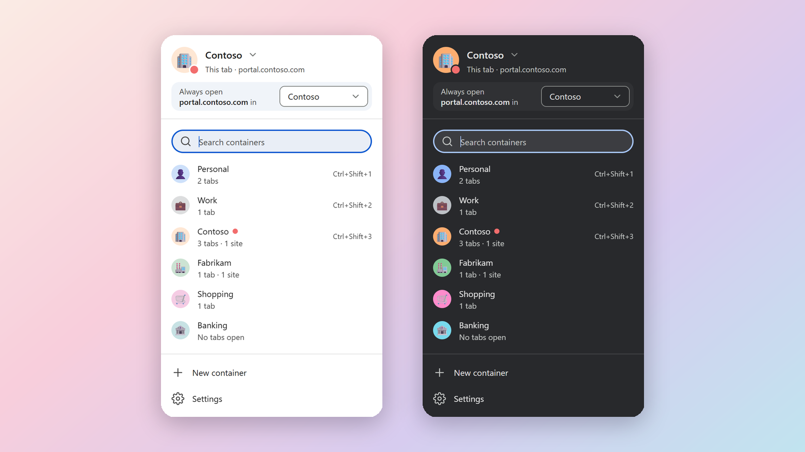
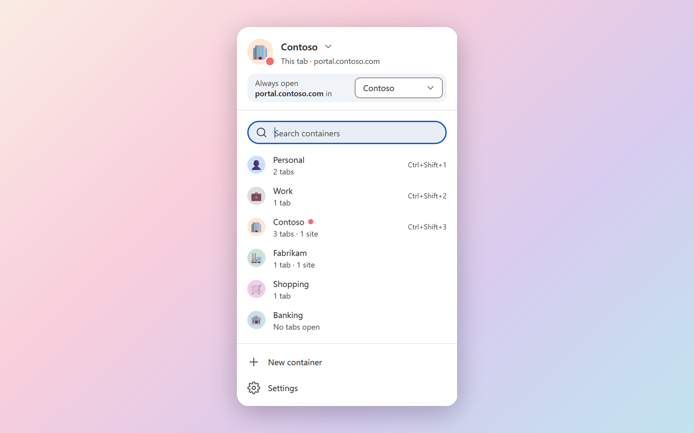
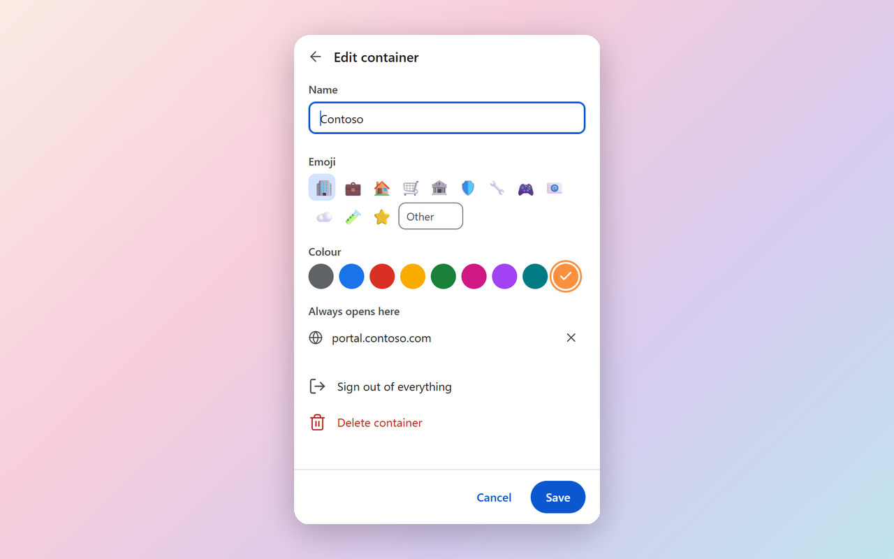
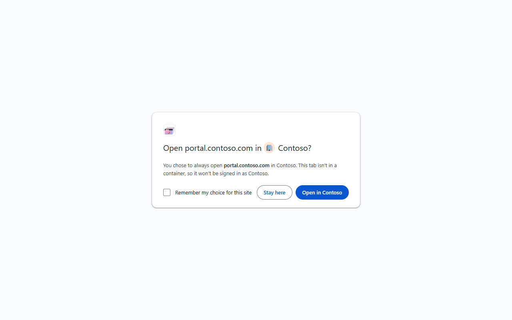
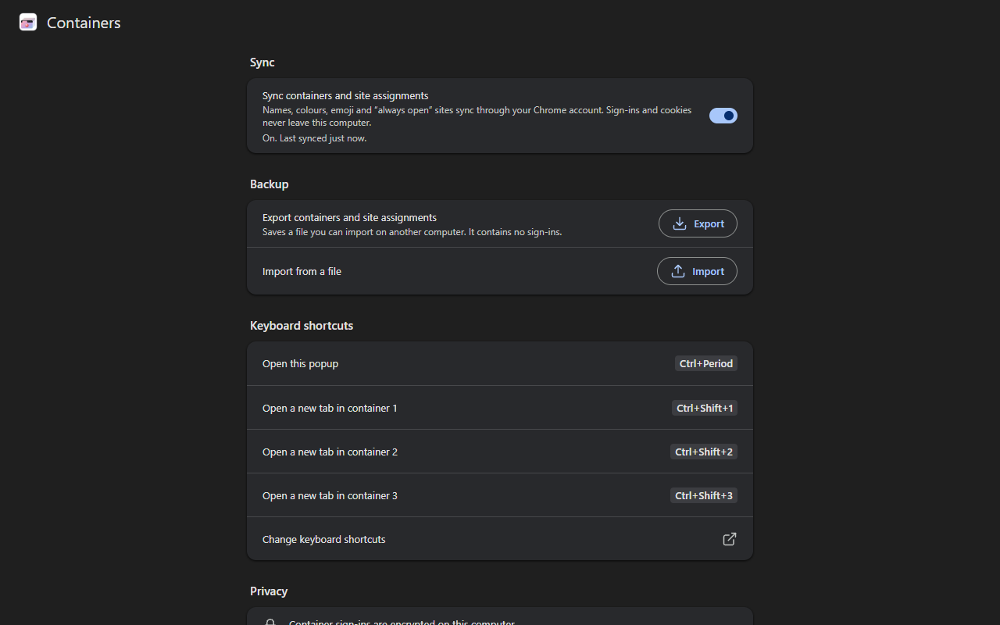

<p align="center"></p>

<h1 align="center">Multi-Account Containers for Chrome</h1>

<p align="center"><b>Stay signed in to several accounts on the same site, side by side in one Chrome window.</b></p>

<p align="center">
  <a href="https://github.com/EY4O/Chrome-MultiAccountContainers/blob/main/LICENSE"></a>
  <a href="https://github.com/EY4O/Chrome-MultiAccountContainers/commits/main"></a>
  <a href="https://ko-fi.com/looneth"></a>
</p>

A Chrome extension that brings the idea of Firefox's Multi-Account Containers to Chrome. Each container keeps its own cookies and site data, and shows up as a Chrome tab group, so a personal Gmail, a work Gmail and a client's Microsoft 365 can all be open at once without signing each other out. It's built for people who juggle accounts all day: IT and MSP work across client tenants, freelancers, or just separating personal from work. It appears in Chrome as **Containers**.



> **🚧 Early release (0.2.0).** Tested daily with Gmail, Discord and GitHub, and by automated suites. Not yet on the Chrome Web Store, so it installs with **Load unpacked**. This is an independent project, not made by or affiliated with Mozilla.

---

## ✨ Key Features

- 🗂️ **Containers as tab groups**: each container is a coloured, named tab group; new tabs opened inside it stay in it, and dragging a tab in or out moves it between containers.
- 🔐 **Separate sign-ins**: cookies, `localStorage`, `sessionStorage` and IndexedDB are kept apart per container, and Chrome's own Google and Microsoft device sign-in can't leak into a container.
- 📌 **Always open this site in…**: assign a site to a container; opening it anywhere else asks "Open in Contoso?" before a single request leaves the tab.
- 🔄 **Survives restarts**: container tabs come back signed in after Chrome restarts, restored from their tab groups.
- 🕒 **Signs itself out**: by default a container signs out when Chrome closes, after 4 hours without use, and when the computer locks; each can be changed.
- 🏢 **Ready for managed computers**: an administrator can set and lock every security setting through Chrome policy (see the [configuration guide](docs/CONFIGURATION.md)).
- 🖱️ **Right-click and keyboard**: open a link in a container, reopen a tab in another one, and open containers with **Ctrl+Shift+1/2/3** (**Ctrl+Period** opens the popup).
- ☁️ **Optional sync and backup**: container names, colours, emoji and site assignments can sync through your Chrome account (off by default); sign-ins never leave the computer. Export and import a backup file too.
- 🎨 **Looks like Chrome**: the popup, prompt and settings follow Chrome's own Material styling, light and dark.

## 📸 Screenshots

| | |
|---|---|
|  **Popup**: this tab's container, "Always open … in", search, and every container with its tabs and sites |  **Edit container**: name, any emoji, the nine tab-group colours, assigned sites, sign out, delete |
|  **Open in…? prompt**: shown when an assigned site opens outside its container |  **Settings**: sync, backup, keyboard shortcuts and privacy notes |

<sub>Screenshots use sample data.</sub>

---

## 📦 Installation

### Option 1: **Release download** (Recommended)

1. Download the `containers-<version>.zip` file from the [latest release](https://github.com/EY4O/Chrome-MultiAccountContainers/releases) and unzip it to a folder you'll keep.
2. Open `chrome://extensions` and turn on **Developer mode**.
3. Click **Load unpacked** and pick the unzipped folder (the one with `manifest.json`).
4. Pin **Containers** to the toolbar.

To update: unzip the new version over the old folder, then press the reload arrow on the extension's card. Your containers and sign-ins are kept.

### Option 2: **Build from source**

Needs [Node.js](https://nodejs.org/) 22 or newer.

```bash
git clone https://github.com/EY4O/Chrome-MultiAccountContainers.git
```

```bash
cd Chrome-MultiAccountContainers
```

```bash
npm install
```

```bash
npm run build
```

Then load the `dist` folder with **Load unpacked**, as in Option 1.

### Option 3: **Managed computers**

On computers you manage with Intune, Group Policy or the Google Admin console, Chrome can install it for everyone and lock its settings. The **[configuration guide](docs/CONFIGURATION.md)** covers the extension ID, every policy setting with an example, recommended values, and offboarding.

<details>
<summary><b>Recommended Chrome setting</b></summary>

Chrome's own Google sign-in (the profile picture at the top right) can sign the browser in again from inside a website. The extension removes the headers Chrome uses for this in container tabs, and that's been checked with real accounts. For the strongest separation, also turn off **Allow Chrome sign-in** in `chrome://settings/syncSetup`.
</details>

## 🚀 Getting Started

1. Click the **Containers** icon and choose **New container**. Give it a name, an emoji and a colour, then **Save**.
2. Click the container in the list. A new tab opens inside its tab group.
3. Sign in to a site there. Open the same site in a normal tab: you're not signed in there.
4. To keep a site in one container, open the popup on that site and pick a container under **Always open *site* in**.
5. Right-click a link and choose **Open link in container** to send it straight to one.

Containers sign out when Chrome closes, after 4 hours without use, and when the computer locks. To stay signed in across restarts, turn on **Settings → Stay signed in after Chrome closes**.

---

## 📖 How It Works

<details>
<summary><b>🍪 How a container keeps its own cookies</b></summary>

Chrome has no containers of its own, so the extension virtualizes cookies per tab:

- **Outgoing:** `declarativeNetRequest` session rules, scoped to each container's tab ids, set the `Cookie` header from that container's cookie jar. The profile's real cookies are never sent from a container tab.
- **Incoming:** `Set-Cookie` is removed before Chrome stores it, and the extension writes it into the container's jar instead.
- **In the page:** a script that runs before the page's own code gives `document.cookie`, `localStorage`, `sessionStorage` and IndexedDB a per-container view.
- **New tabs:** a tab opened from a container tab, or created inside its group, joins that container. Until it's been assigned, its requests are held back, so nothing goes out with the wrong identity.
- **After a restart:** every request is blocked until the extension has put the restored tabs back into their containers, then the blocked loads are replayed.
</details>

<details>
<summary><b>📌 Site assignments</b></summary>

Assignments are by exact host (`portal.contoso.com`). Opening an assigned site in any other tab is redirected, before any request leaves, to a page offering **Open in *container*** or **Stay here**, with **Remember my choice for this site**.

Some tools serve every customer from the same address (Autotask, Intune), so a site alone can't say which client you mean. For those, open the client's container first and work from there.
</details>

<details>
<summary><b>🛡️ Security model</b></summary>

**What containers are for.** They stop *accidental* cross-account sign-in: a client's portal opened in the wrong tab, a personal account leaking into a work session, Chrome's own sign-in turning up inside a container. They are **not** a security boundary against a malicious or compromised website. A container runs in the same browser profile as everything else, and a hostile page could find ways around separation done inside the page.

**What's protected, and how.**

- **Cookies** are kept out of Chrome's cookie store. Each container's cookies are stored encrypted (AES-256-GCM) with a key of its own.
- **Where that key lives** depends on **Stay signed in after Chrome closes** (`keyStorage`). Off (the default): only in Chrome's memory for the browser session, so closing Chrome, or updating the extension, signs every container out. On: in the extension's storage on disk, next to the encrypted cookies. Then the encryption only keeps cookies out of plain sight; someone who can read the whole profile can read them.
- **Site storage** (`localStorage`, `sessionStorage`, IndexedDB) is kept apart *inside the page*: each container's keys get their own prefix in the site's normal storage. It is **not encrypted**. Signing a container out changes its prefix, so tokens sites left there become unreachable, but the old data stays in the site's storage until browsing data is cleared.
- **Web Workers** get no content script. A dedicated worker's requests still carry its container's cookies, but IndexedDB used from inside a worker is **not** separated: normal tabs of the same site share it. The test suite checks both.
- **Signing out**: a new key, an empty cookie jar and a new storage prefix. It happens on demand (**Sign out of everything** in the edit panel, **Sign out of all containers** in Settings), after the idle timeout (4 hours by default, counting only real use: switching to a tab, clicking, typing or scrolling), when the computer locks, and, by default, when Chrome closes.
- **Device sign-in** is kept out of container tabs: the headers Chrome uses to sign the browser in to Google (always), Windows' Microsoft device sign-in, and Device Bound Session Credentials (both settings, on by default). A side effect of the Microsoft one: Conditional Access rules that require a compliant device will block container tabs, so use a normal tab for your own organization's tenant.
- **Sync** is off by default. When on, it sends container names, colours, emoji and the addresses of assigned sites (not sign-ins) to the Google account the Chrome profile is signed in to. Turning it off removes them from the account.
- **The "Open in…?" page** can't be loaded or framed by websites, so a site can't use it to move a tab into a container.
- **No servers, no analytics:** the extension makes no network requests of its own.
</details>

<details>
<summary><b>⚠️ Known limits</b></summary>

- The HTTP cache, Cache API, BroadcastChannel and SharedWorkers are shared between containers, and so is IndexedDB used from inside a Web Worker. Cookies aren't affected, but a site could tell it's been visited before, and a site that keeps tokens in worker IndexedDB shares them with normal tabs.
- A cookie set during a redirect inside a background request (rare, on some sign-in flows) can be missed, and the site may ask you to sign in again.
- Dragging a single tab to a new window takes it out of its group, so it leaves the container. Dragging the whole group keeps it.
- Chrome limits how many rules an extension can have; with very many busy containers, the least recently used ones are signed out rather than leaked.
- "Only allow assigned sites in this container" isn't built yet.
</details>

<details>
<summary><b>🔑 Permissions it asks for</b></summary>

| Permission | Why |
|---|---|
| Read and change data on all websites | Set and capture each container's cookies on whatever sites you use |
| `declarativeNetRequest`, `webRequest` | Rewrite cookie headers per tab, and see the cookies sites set |
| `tabs`, `tabGroups`, `webNavigation` | Know which tab belongs to which container, and keep tab groups in step |
| `storage`, `unlimitedStorage` | Keep containers and their encrypted cookie jars, and read settings set by Chrome policy |
| `browsingData` | Remove a site's service workers so they can't answer for a container |
| `alarms` | The 15-minute check for containers past the idle timeout |
| `idle` | Notice when the computer locks, to sign containers out (no network access) |
| `contextMenus` | The right-click menus |
</details>

---

## 🧪 Development

Building, the test suites, the real-Chrome sandbox and releasing are described in **[docs/DEVELOPMENT.md](docs/DEVELOPMENT.md)**.

## 🤝 Contributing

Issues and pull requests are welcome. Please run `npm test` and `npm run e2e` before opening a PR.

## 🙏 Credits

- [Firefox Multi-Account Containers](https://github.com/mozilla/multi-account-containers): the original idea and the way it works for people. No code was copied from it.
- [esbuild](https://esbuild.github.io/): bundling.
- [Puppeteer](https://pptr.dev/) and Chrome for Testing: the end-to-end tests.
- [Feather Icons](https://feathericons.com/): interface icons.

## ☕ Support

If Containers saves you from signing in and out all day, you can support its development:

[](https://ko-fi.com/looneth)

## 📄 License

[MIT](LICENSE)

## 📜 Changelog

<details>
<summary><b>Every version, newest first</b></summary>

Each version's full notes are on its [release page](https://github.com/EY4O/Chrome-MultiAccountContainers/releases).

- **0.2.0**: Hardened for managed computers: containers sign out when Chrome closes, after 4 hours without use and when the computer locks, sync is off by default, and an administrator can lock every security setting through Chrome policy.
- **0.1.0**: First release: containers as tab groups with separate sign-ins, site assignments, right-click menus, shortcuts, sync and backup.

</details>
